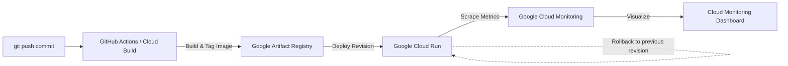

# ci-container-monitoring-lab

A small, fully local DevOps stack that wires a single commit all the way to a
running, monitored service:

**commit → CI → container → deploy → dashboard**

The stack contains:

- **app/** — a Node.js + Express service exposing `/`, `/health`, `/metrics` and `/work`
- **Dockerfile** — builds the service image
- **docker-compose.yml** — runs the app, Prometheus and Grafana together
- **prometheus/** — Prometheus scrape configuration
- **grafana/** — provisioned datasource and a "Service Overview" dashboard
- **.github/workflows/ci.yml** — GitHub Actions pipeline (install, test, build, smoke test)

Everything runs locally and for free. No cloud account or billing is required.

## Prerequisites

- Docker + Docker Compose
- Node.js 18+ (only needed if you want to run tests outside a container)
- `git`, `curl`

## Run the stack

```bash
docker compose up -d          # build + start app, Prometheus, Grafana
docker compose ps             # show container status and health
docker compose logs -f app    # follow the application logs
```

Services once up:

| Service     | URL                      |
|-------------|--------------------------|
| App         | http://localhost:8080    |
| Prometheus  | http://localhost:9090    |
| Grafana     | http://localhost:3000    |

Grafana logs in anonymously (admin/admin also works). Open the **Service
Overview** dashboard under the **Lab** folder.

Tear down:

```bash
docker compose down
```

## Verify the service

```bash
curl localhost:8080/health     # -> {"status":"ok"}
curl localhost:8080/           # -> service metadata
curl localhost:8080/metrics    # -> Prometheus metrics
```

Check the Prometheus scrape target:

```
http://localhost:9090/targets   # the app target should be UP
```

## Generate sample traffic

```bash
./scripts/generate-traffic.sh                       # defaults to localhost:8080
./scripts/generate-traffic.sh http://localhost:8080 500
```

Then watch the panels in the Grafana **Service Overview** dashboard update.

## Run the tests locally

```bash
cd app
npm install
npm test
```

## GitHub Actions

The workflow in `.github/workflows/ci.yml` runs automatically on every push and
pull request. It installs dependencies, runs the unit tests, builds the Docker
image and smoke-tests the running container. Watch it under the **Actions** tab
of your fork, or trigger it by pushing a commit / opening a PR.

## Rollback

Releases are tagged in Git. You can inspect history with:

```bash
git log --oneline
git tag
```

To roll a bad release back to a previous version, either revert the offending
commit and redeploy, or rebuild from a previous tag:

```bash
git revert <commit>          # revert a bad release
docker compose up -d --build # redeploy the reverted version
```

## Cloud Mapping (Production Architecture)

This local, zero-cost development stack maps 1:1 to Google Cloud managed production services without requiring local machine orchestration:

| Stage | Local Development Flow | Managed Cloud Service | Cloud Implementation Details |
| :--- | :--- | :--- | :--- |
| **Source & CI** | Git commits + GitHub Actions (`ci.yml`) | **GitHub Actions / Cloud Build** | Triggers on commit/PR, executes automated tests, and creates container build triggers. |
| **Image Registry** | Local Docker image cache (`ci-container-monitoring-lab:local`) | **Google Artifact Registry** | Secure repository for versioned container images (e.g., `us-central1-docker.pkg.dev/$PROJECT_ID/lab-repo/app:$COMMIT_SHA`). |
| **Container Runtime** | Docker Compose (`docker compose up`) | **Google Cloud Run** | Fully managed serverless container runtime with autoscaling, HTTPS termination, and revision management. |
| **Health Checks** | Compose `healthcheck` (`curl /health`) | **Cloud Run Startup & Liveness Probes** | Automated health checks querying `/health` to route traffic only to ready instances. |
| **Metrics Collection** | Prometheus scraping (`app:3000/metrics`) | **Google Cloud Monitoring (Metrics Explorer)** | Scrapes Prometheus-formatted metrics via Google Cloud Managed Service for Prometheus or Cloud Monitoring agent. |
| **Observability** | Grafana "Service Overview" Dashboard | **Google Cloud Monitoring Dashboards** | Custom dashboards tracking request rates, route breakdowns, and p95 latencies. |
| **Rollback Strategy** | `git revert <commit>` + `docker compose up -d` | **Cloud Run Revision Traffic Splitting** | Instant atomic rollback to previous revision: `gcloud run services update-traffic app --to-revisions=PREV_REVISION=100`. |

### Cloud CI/CD Deployment Workflow



---

## Integration Gaps & Repairs Summary

1. **Build and Deploy Sequencing (CI)**:
   - Upgraded Node.js runner from deprecated `12` to `20`.
   - Added dependency installation (`npm ci`) prior to running unit tests (`npm test`).
2. **Config Consistency (Ports & Environment)**:
   - Aligned published ports in `docker-compose.yml` (`8080:3000`) with in-container port (`3000`).
   - Added `MAINTENANCE_MODE=off` to ensure health probes return HTTP 200 `{"status":"ok"}`.
3. **Monitoring Visibility (Prometheus & Grafana)**:
   - Corrected Prometheus scrape metrics path to `/metrics` (was `/prometheus`).
   - Pointed Prometheus target to container service `app:3000` (was `app:9090`).
   - Corrected Grafana datasource URL to `http://prometheus:9090` (was `http://prometheus:9091`).
4. **Rollback Readiness**:
   - Verified service recovery via Git revert and redeployment, returning unhealthy/maintenance states to 200 OK.

